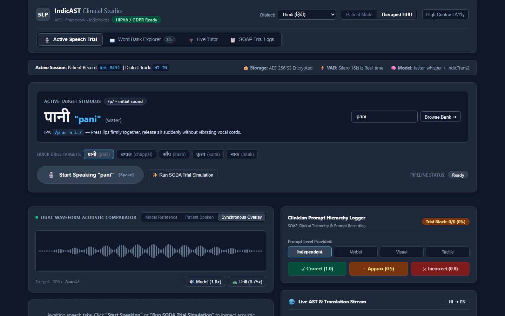
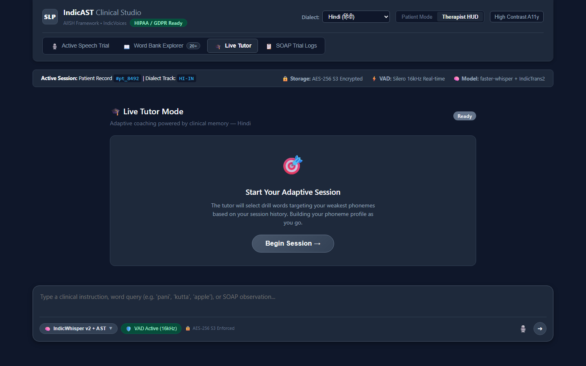
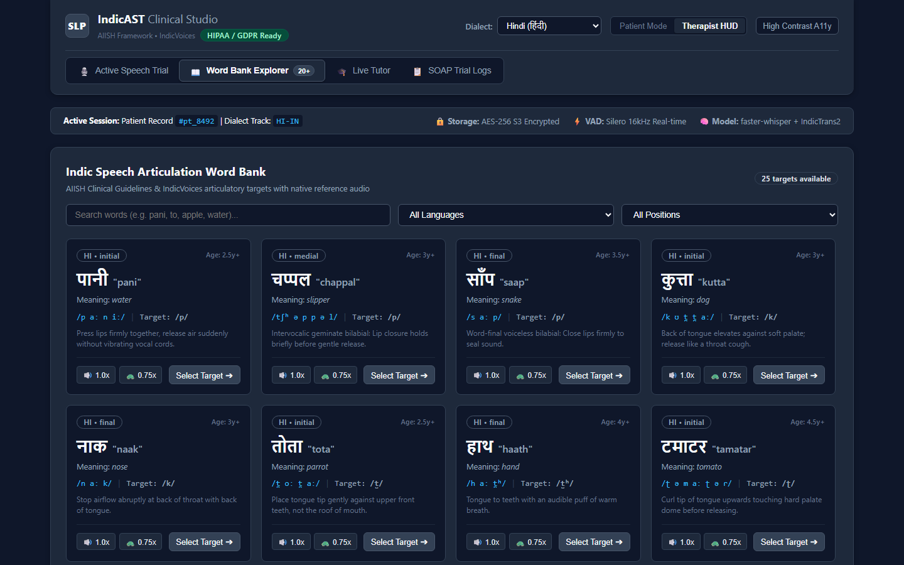
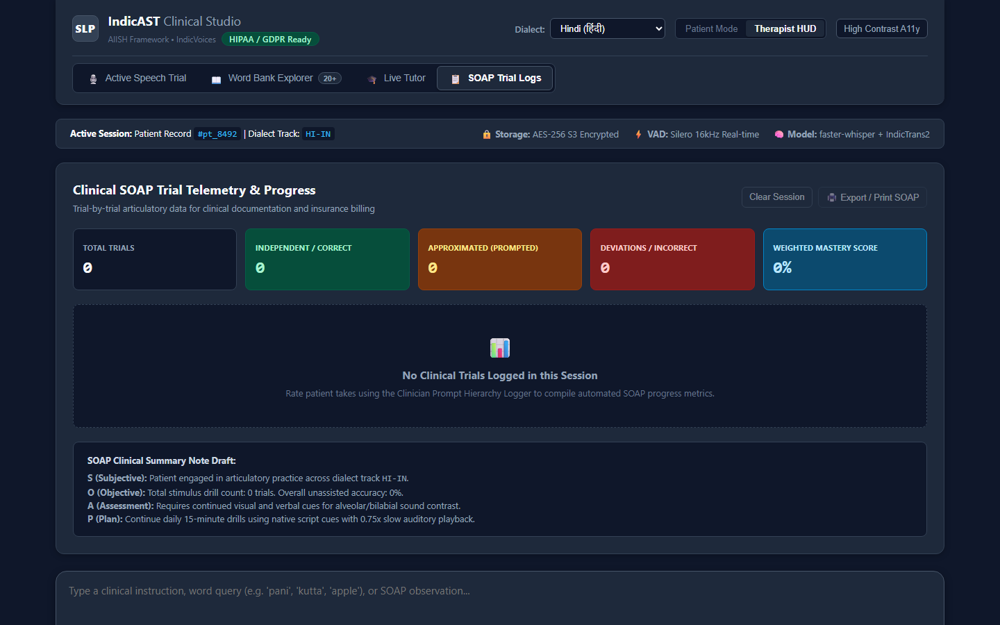

# IndicAST — Enterprise Speech Therapy Platform

A full-stack, AI-assisted speech therapy platform for Indian dialects, combining a
FastAPI acoustic-engine backend with a React/TypeScript clinical studio frontend.
HIPAA/GDPR-aware: de-identified memory keys, encrypted audio at rest, consent-driven
retention policies, and RBAC-protected APIs.

## Screenshots

### Active Speech Trial — Therapist HUD
Live target stimulus, quick drill targets, dual-waveform acoustic comparator,
and the clinician prompt-hierarchy logger (Independent / Verbal / Visual / Tactile).



### Live Tutor Mode — Adaptive Coaching
The tutor selects drill words targeting the patient's weakest phonemes using the
shared clinical memory layer, with streak-aware encouragement and adaptive difficulty.



### Word Bank Explorer



### SOAP Trial Logs



## Features

- **Live Speech Trial** — stream 16-bit/16 kHz PCM over WebSocket; VAD-gated
  transcription (faster-whisper) with live Indic→English AST and phonetic
  articulation diagnosis.
- **Live Tutor Mode** — adaptive real-time coaching. Every attempt flows through the
  shared clinical memory layer, so the tutor *learns as you go*: weak phonemes feed
  target selection, consecutive streaks escalate/de-escalate difficulty, and memory
  recorded in earlier trials (or via any other feature) warms up the next session
  in advance.
- **Clinical Memory Layer** — per-patient phoneme error counts, EMA mastery scores,
  ranked weak phonemes, streak counters, and a rolling utterance window. Redis-backed
  with hashed (de-identified) keys and a 30-day TTL; falls back to in-memory storage
  when Redis is unavailable.
- **Word Bank Explorer & SOAP Logs** — Indic word bank (hi/kn/ta/te/en-IN) with
  native scripts and IPA, plus structured trial logs.
- **Access Control** — JWT auth with role-based access control (therapist / patient /
  admin). Patients can only read their own memory; only therapists and admins can
  reset it (HIPAA deletion pathway).

## Technology Stack

### Backend (Python 3.11 / FastAPI)
- **FastAPI + WebSockets** — `/ws/live-ast` (real-time AST) and `/ws/live-tutor`
  (adaptive tutoring loop).
- **faster-whisper** — Indic speech-to-text (falls back to simulation mode if the
  model is unavailable).
- **SQLAlchemy 2 (async) + Alembic** — PostgreSQL in production, SQLite for local dev.
- **Redis + Celery** — async worker queue and clinical memory store.
- **Prometheus + OpenTelemetry** — application metrics and distributed traces.

### Frontend (React 19 + TypeScript + Vite)
- Zustand-style external store (`therapyStore`), custom WebSocket protocol hooks,
  four clinical views, high-contrast accessibility mode.

## Next-Level Backend & Infra Integrations

### A. Database Schema Versioning (Alembic)
Zero-downtime schema migrations for Kubernetes / Docker upgrades.

```bash
cd backend
alembic revision --autogenerate -m "describe change"
alembic upgrade head
```

- Config in `/alembic.ini`; async engine wired in `backend/migrations/env.py`
  (`target_metadata = Base.metadata`).
- Initial schema migration: `backend/migrations/versions/001_initial_schema.py`.

### B. Enterprise Identity Provider (OIDC / JWKS)
Hospitals, schools, and private clinics can sign in with their existing identity
providers — **Auth0, AWS Cognito, Firebase Auth, Google Workspace, Microsoft Entra
ID / Azure AD** — with automatic role mapping for clinicians and patients.

- `backend/app/core/security.py` verifies RS256 tokens against the provider's
  JWKS endpoint (cached 1 h), with audience + issuer checks.
- Role mapping priority: explicit `role` claim → enterprise group claims
  (e.g. Azure AD groups) → clinician email-domain allow-list → default `patient`.
- Configure via env vars (see `.env.example`):

```ini
OIDC_ENABLED_PROVIDERS=auth0,azure
OIDC_JWKS_URLS={"auth0":"https://YOUR_TENANT.auth0.com/.well-known/jwks.json"}
OIDC_CLIENT_IDS={"auth0":"YOUR_CLIENT_ID"}
OIDC_ISSUERS={"auth0":"https://YOUR_TENANT.auth0.com/"}
CLINICIAN_EMAIL_DOMAINS=@hospital.org
```

When unset, the platform uses its own HS256 JWTs.

### C. Asynchronous Worker Queue (Redis + Celery)
Heavy batch jobs (SFT dataset exports, analytics, retention cleanup) run in a Celery
worker pool so they never block the real-time WebSocket event loop.

- `backend/app/worker/celery_app.py` — broker/backend config, beat schedule,
  per-task rate limits.
- `backend/app/worker/tasks.py` — `export_sft_dataset_task` (JSONL export),
  `run_batch_analytics_task` (recomputes phoneme mastery into the memory layer),
  `cleanup_expired_audio_task` (daily retention sweep).
- Docker Compose ships `redis`, `worker`, and `beat` services.

```bash
docker compose up -d redis worker beat
```

### D. Production Observability (Prometheus & OpenTelemetry)
- **Prometheus** — standard HTTP metrics at `GET /metrics` plus custom clinical
  metrics: `indicast_ws_active_connections`, `indicast_ast_inference_latency_seconds`,
  `indicast_phoneme_error_total`, `indicast_tutor_sessions_total`.
- **OpenTelemetry** — FastAPI traces exported via OTLP/HTTP
  (`OTEL_EXPORTER_OTLP_ENDPOINT`, default `http://localhost:4318`).
- Grafana dashboards and Prometheus scrape config under `observability/`.

```bash
docker compose -f docker-compose.yml -f docker-compose.observability.yml up -d
# Grafana: http://localhost:3000 (admin/admin) · Prometheus: http://localhost:9090
```

## Project Structure

```
speech-therapy/
├── backend/
│   ├── app/
│   │   ├── api/            # REST routers (auth, sessions, exercises, memory)
│   │   ├── core/           # Config, security (JWT + OIDC/JWKS), logging
│   │   ├── db/             # Async engine, models
│   │   ├── services/       # live_ast, live_tutor, memory, phonetics, storage, mlops
│   │   └── worker/         # Celery app + tasks
│   ├── migrations/         # Alembic versions
│   ├── tests/              # pytest suite (26 tests)
│   └── Dockerfile
├── frontend/               # React 19 + TypeScript + Vite clinical studio
├── docs/screenshots/       # Product screenshots used in this README
├── observability/          # Prometheus / Grafana / OTel collector configs
├── docker-compose.yml
├── docker-compose.observability.yml
└── .github/workflows/ci.yml
```

## Getting Started

### Backend

```bash
pip install -r backend/requirements.txt
cp .env.example backend/.env           # fill in what you need

# Local dev (SQLite + in-memory memory layer — Redis optional)
python -m uvicorn backend.app.main:app --host 0.0.0.0 --port 8000 --reload
```

Health check: `GET http://localhost:8000/health`

### Frontend

```bash
cd frontend
npm install
npm run dev            # http://localhost:5173
```

### Full Production Stack

```bash
docker compose up -d                      # redis, postgres, app, worker, beat
docker compose -f docker-compose.yml -f docker-compose.observability.yml up -d
```

### Deep Links

Each view is directly deep-linkable: `http://localhost:5173/?tab=trial|tutor|wordbank|history`

## Testing & CI

```bash
python -m pytest -o pythonpath=. backend/tests -v    # backend
cd frontend && npm run lint && npm run build         # frontend
```

CI (`.github/workflows/ci.yml`) runs the backend test suite, frontend lint +
production build, and Docker Compose config verification on every push/PR.

## Contributing

Contributions welcome. Ensure `pytest`, `npm run lint`, and `npm run build` pass,
and keep any new database changes in an Alembic migration.
